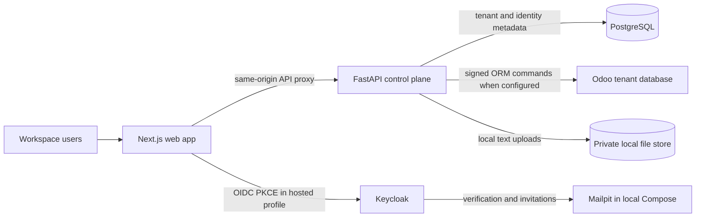

# Nexora One architecture

This page describes the code that exists in the repository today and separates it from planned production services. Nexora One is currently a modular monolith with a single Next.js application, a FastAPI service, a PostgreSQL control plane, and an optional Odoo service per tenant.

## System context

The web app can run in two development profiles:

| Profile | Identity | API and persistence | External services |
|---|---|---|---|
| VS Code local demo | Fixed local development identity; no password | FastAPI with local PostgreSQL; illustrative UI records are held in browser storage and API-backed resources use the API | Keycloak and Odoo are offline |
| Docker Compose | Keycloak OIDC with PKCE | FastAPI and PostgreSQL; tenant ERP data is provisioned to Odoo | Keycloak, Mailpit and Odoo are included for development |

These profiles are development configurations. Neither represents a production deployment.

## Runtime request flow

1. The Next.js client selects the local demo identity or starts the OIDC authorization flow. OIDC access tokens stay in browser memory.
2. The client sends API calls through the Next.js `/api-proxy/*` rewrite. The rewrite targets `API_ORIGIN`, defaulting to `http://localhost:8000`.
3. FastAPI assigns a request ID and validates either the local-only demo token, an API client credential, or an OIDC JWT against the configured issuer, audience and JWKS.
4. Tenant-scoped routes resolve an active membership from `X-Tenant-ID`; role and branch checks run on the server. Tenant context is set transaction-locally for PostgreSQL row-level security.
5. The API persists control-plane and operational records in PostgreSQL. Supported ERP operations call the tenant's Odoo database through a signed gateway command.
6. Responses include the request ID. Audit events are written for sensitive workspace changes.

## Service and code boundaries

| Boundary | Code location | Owns today |
|---|---|---|
| Web application | `apps/web/app/` | Workspace shell and screen registry (`modules.ts`), UI state and API orchestration (`page.tsx`), reusable overview/table/settings components, local illustrative data (`demo-data.ts`) and shared record types |
| API composition and control plane | `services/api/app/main.py` | FastAPI setup, workspace and branch routes, membership management, audit, core ERP records, idempotency, budget handling and Odoo coordination |
| People workflows | `services/api/app/hr.py`, `payroll.py` | Employee, shift, attendance, leave, compensation and payroll endpoints; payroll arithmetic is isolated as a pure calculation module |
| Flexible workspace resources | `services/api/app/extended.py` | Tenant-scoped operations, commerce metadata, document endpoints, approvals, imports, reports, workflows and API-client management |
| Persistence and contracts | `services/api/app/models.py`, `schemas.py`, `migrations/` | SQLAlchemy entities, Pydantic request validation and Alembic schema history |
| Authentication and tenant access | `services/api/app/security.py`, `api_credentials.py` | OIDC JWT, development token and one-time branch-scoped API-client validation; role gates and membership resolution |
| ERP gateway | `services/api/app/odoo.py`, `odoo/addons/nexora_gateway/` | Tenant DB setup and signed commands to supported Odoo ORM operations |
| Identity presentation | `identity/` | Local Keycloak realm/client configuration and the Nexora One login theme |
| Developer/runtime configuration | `.vscode/`, `compose.yaml`, `.github/workflows/` | No-Docker VS Code tasks, optional service composition and CI validation |

The API is a modular monolith. Route modules are separated by domain, but share one process, SQLAlchemy session pattern and PostgreSQL database. `main.py` remains the composition point and still owns several core domains; a future refactor can move those routes into focused routers without introducing network service boundaries.

## Data ownership

- **PostgreSQL control plane:** tenants, memberships, branches, profile preferences, invitations, audit events, idempotency receipts, HR/payroll entities and flexible phase 4–5 resources.
- **Odoo per tenant:** authoritative ERP records and accounting operations for the gateway commands that are implemented and configured. The gateway uses Odoo ORM methods inside the Odoo transaction; the API must not write to Odoo business tables with SQL.
- **Browser storage:** illustrative demo records in `NEXT_PUBLIC_LOCAL_DEMO` mode. Demo IDs are marked and UI actions reject edits to those illustrative rows.
- **Local document store:** uploaded UTF-8 `.txt` files are stored under a tenant-specific private directory with restrictive permissions. Rich attachments, object storage, malware scanning and retention controls are not implemented.

Phase 4–5 resources are intentionally stored as flexible tenant-scoped records while provider integrations are unavailable. They do not replace Odoo's accounting ledger or constitute a connected checkout, fulfillment, portal or external AI integration.

## Tenancy and authorization invariants

- Every business query scopes by the active membership's `tenant_id`; client-supplied tenant IDs alone do not grant access.
- PostgreSQL RLS is defense in depth for the tenant-keyed tables covered by Alembic policies. The API sets `app.tenant_id` with transaction-local `set_config` so pooled connections do not retain tenant context.
- Branch restrictions are checked on API operations where branch-scoped data is supported. High-risk related records must resolve to the same tenant and, for restricted roles, an assigned branch.
- API-client secrets are random, shown once, stored as SHA-256 digests, tenant- and branch-scoped, expiring and revocable. They are restricted to supported non-owner roles.
- Financial and inventory writes require idempotency keys. Versioned updates reject stale changes. Protected transitions use explicit commands and write audit events.
- OIDC, local demo identity and API-client credentials are separate authentication paths. `LOCAL_DEMO_MODE` must never be enabled for a shared or deployed API.

Review the exact role matrix in [permissions](permissions.md) and remaining release gates in [phases](phases.md).

## Migrations and startup

FastAPI startup runs Alembic migrations to `head`. The migration chain begins at `services/api/migrations/versions/0001_control_plane.py`. Migrations should remain forward-compatible and must be reviewed against both PostgreSQL and the local Compose configuration. A production release still needs an explicit migration rollout/rollback procedure and a demonstrated backup restore.

## Current limits and next architecture steps

- Tenant Odoo provisioning currently runs inside the workspace creation request; there is no worker queue or retry scheduler.
- Redis, Celery, object storage, OpenTelemetry tracing, provider webhooks and background scheduling are not installed.
- `page.tsx` currently coordinates much of the web session, module state and API behavior. As the feature set grows, move these responsibilities into domain hooks and feature folders while preserving `modules.ts` as the screen registry.
- Flexible resource records are suitable for local operational metadata; stable domains should migrate to typed tables and versioned contracts when workflows need stronger invariants or reporting volume.
- The existing CI runs Python syntax, domain unit checks, Compose configuration, ESLint and a Next.js production build. It does not yet verify tenant isolation against live PostgreSQL, Odoo workflows, browser journeys, migrations from populated data, or backup recovery.
- Local Keycloak, Mailpit and HTTP endpoints are for development. Production secret management, TLS, rate limiting, monitoring, incident response and recovery remain open.

## Key decisions

1. Begin as a modular monolith and add asynchronous infrastructure only when a real workload needs it.
2. Keep accounting calculations and posting inside Odoo; do not mirror the ledger in the control plane.
3. Keep OIDC tokens in memory and validate identity at the API boundary.
4. Use tenant-scoped SQL plus PostgreSQL RLS as defense in depth.
5. Prefer provider-neutral local workflows where credentials are unavailable, and label their limits in the UI and documentation.
